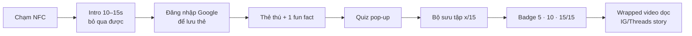
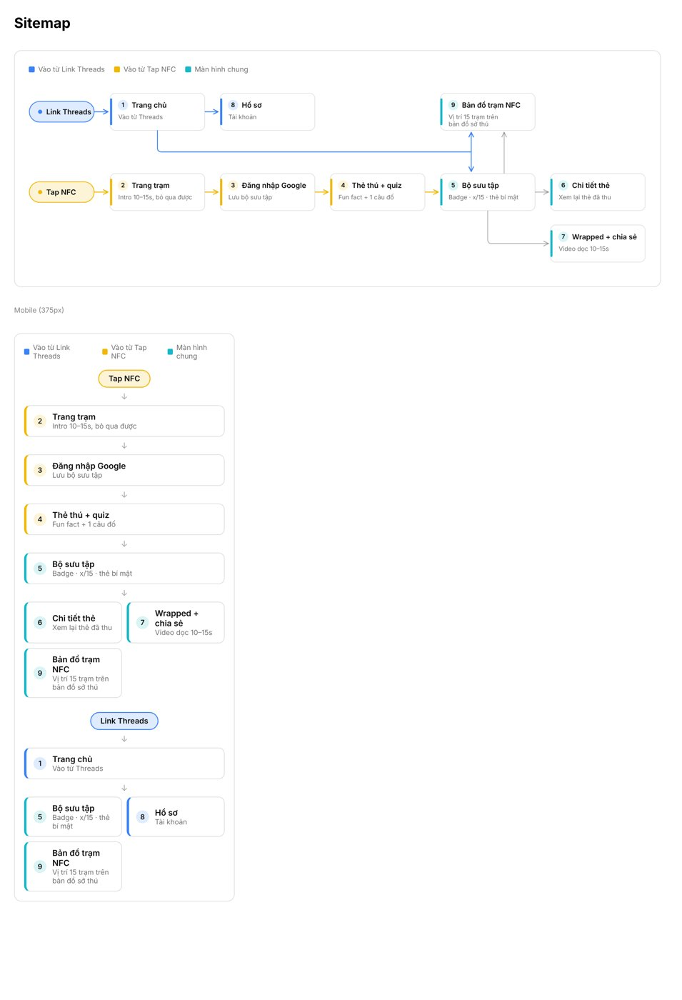

# 02 · Product flow

## Chi tiết
- **Chạm NFC** tại trạm → mở trang trạm.
- **Intro 10–15s**, có nút bỏ qua.
- **Đăng nhập Google** để lưu bộ sưu tập.
- **Thẻ thú + 1 fun fact.**
- **Quiz pop-up:** mỗi trạm 3–4 câu, hiện ngẫu nhiên 1 câu. Sai → thử lại bằng **câu khác**.
- **Badge** ở mốc 5/15, 10/15, 15/15.
- **2–3 trạm Easter Egg ẩn**, không có trên bản đồ.
- **Cuối chuyến:** video **Wrapped dọc cá nhân hóa** để đăng IG/Threads story.
- ❌ Không quà vật lý · ❌ Không story mode.

## Sitemap (9 màn)

| # | Màn | Ghi chú |
|---|---|---|
| 1 | Trang chủ | Vào từ link Threads |
| 2 | Trang trạm | Intro 10–15s, bỏ qua được |
| 3 | Đăng nhập Google | Lưu bộ sưu tập |
| 4 | Thẻ thú + quiz | Fun fact + 1 câu đố |
| 5 | Bộ sưu tập | Badge · x/15 · thẻ bí mật |
| 6 | Chi tiết thẻ | Xem lại thẻ đã thu |
| 7 | Wrapped + chia sẻ | Video dọc 10–15s |
| 8 | Hồ sơ | Tài khoản |
| 9 | **Bản đồ trạm NFC** | Vị trí 15 trạm trên bản đồ sở thú |
