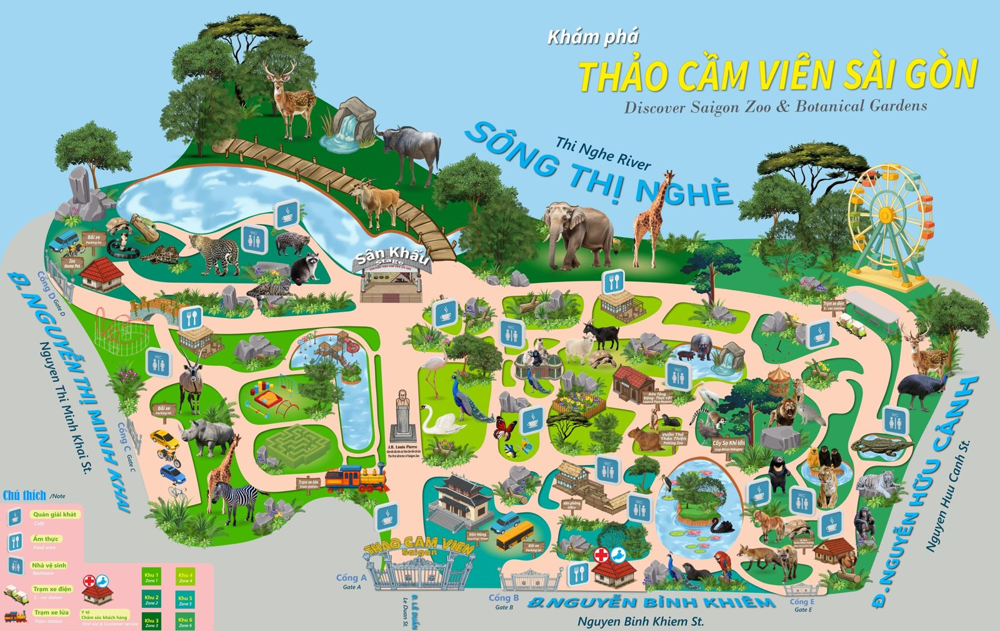

# 03 · 15 trạm NFC (chốt 30/10/2026)

Chỉ chọn loài được trang Thảo Cầm Viên năm 2026 nhắc là đang trưng bày.
Nguồn: **[A]** [Một ngày tại Thảo Cầm Viên (11/3/2026)](https://saigonzoo.vn/mot-ngay-tai-thao-cam-vien-56.html) · **[T]** [Tin tức TCV 2026](https://www.saigonzoo.vn/tin-tuc) · Bản đồ: [ban-do-tcv.jpg](https://saigonzoo.vn/uploads/tin-tuc/tcv/ban-do-tcv.jpg)

| # | Thẻ | Loài | Khu | Fun fact | Phụ kiện SG · nền |
|---|---|---|---|---|---|
| 1 |  | Voi châu Á | Chuồng voi, ven sông | Cụ voi Chuông 66–67 tuổi, "nhân chứng sống" của TCV [A][T] | Bánh mì · mint |
| 2 |  | Hươu cao cổ | Chuồng HCC Nguyễn Bỉnh Khiêm | 2 gia đình; Thái–Lan cùng con Thảo Em, Thái Anh [A] | Nón lá + trà tắc · đào |
| 3 |  | Capybara | Vườn thú thân thiện | Bộ tứ Phú–Quý–Cát–Tường; loài gặm nhấm lớn nhất [A] | Cà phê sữa đá · vàng bơ |
| 4 |  | Meerkat | Vườn thú thân thiện | Luân phiên đứng gác như "vệ sĩ sa mạc" [A] | Kính râm + ống nhòm · cam nhạt |
| 5 |  | Gấu chó (Noel) | Khu chuồng gấu | Loài gấu nhỏ nhất thế giới; Noel mê nước mật ong [A] | Ly nước mật ong · hồng phấn |
| 6 |  | Gấu mèo (Tai Nơ) | Bát giác cây chòi | Thích nằm ngửa trên cành cây cao [A] | Bánh tráng trộn · xanh baby |
| 7 |  | Tê giác trắng | Chuồng tê giác | "Hiền mà nặng ký", cho ăn T7–CN 14h [A] | Mũ bảo hiểm · lavender |
| 8 |  | Hổ Bengal vàng | Khu hổ mới | Hổ Xám chơi kéo co với du khách T7 tuần 1 & 3 [A] | Khăn rằn · cam đào |
| 9 |  | Vượn má vàng | Đảo vượn, hồ sen | Cho ăn mỗi ngày 9h–9h15 [A] | Lá sen làm dù · xanh lá |
| 10 |  | Hồng hạc | Vườn hồng hạc | Đứng một chân, lông trắng phớt hồng [A] | Kẹo bông gòn · hồng sữa |
| 11 |  | Công Ấn | Vườn hồng hạc | Đuôi xòe dài tới 1,5m [A] | Quạt giấy + áo dài · xanh ngọc |
| 12 |  | Cá sấu | Vườn cá sấu | Cho ăn T7–CN 14h–14h15 [A] | Xe đẩy kem · xanh rêu |
| 13 |  | Rùa Sulcata | Khu bò sát | Diễu hành Idol Zoobiz CN tuần 2 & 4 [A] | Mo cau / vé số · be cát |
| 14 |  | Ngựa lùn (Văn Mai) | Chuồng ngựa lùn | Được cắt tỉa bờm trước lễ tết [A] | Xích lô · tím lilac |
| 15 |  | Hà mã lùn (Dzít) | Chuồng hà mã | Dzít 35 tuổi, được đánh răng T7–CN 15h [A] | Bàn chải + phao bơi · xanh biển |

## 🥚 Easter Egg (ẩn, không có trên bản đồ)
- **Mèo cam Mika** – "trưởng chuồng gấu" [A]
- **Thiên nga Dương – Hảo** – cặp đôi ở Vườn hồng hạc [A]
- **Già đẫy Java** – "tổ trưởng" khu hồ nước [A]

## Dự phòng
 **Đười ươi** – rút khỏi 15 trạm vì tin gần nhất (chú Tèo) là 6/2022, chưa xác nhận còn trưng bày.

## Loại bỏ
Sư tử (Mimi mất 10/2026), hổ trắng, hà mã lớn (Chia mất 5/2025). Hà mã lùn là loài khác nên vẫn giữ.

## Tuyến gợi ý
Cổng → hươu cao cổ, voi → Vườn thú thân thiện → hồ sen/đảo vượn → vườn hồng hạc → bò sát/cá sấu → tê giác, ngựa lùn → gấu, gấu mèo → hổ, hà mã lùn.
*Cách đặt trạm: chưa chốt.*

