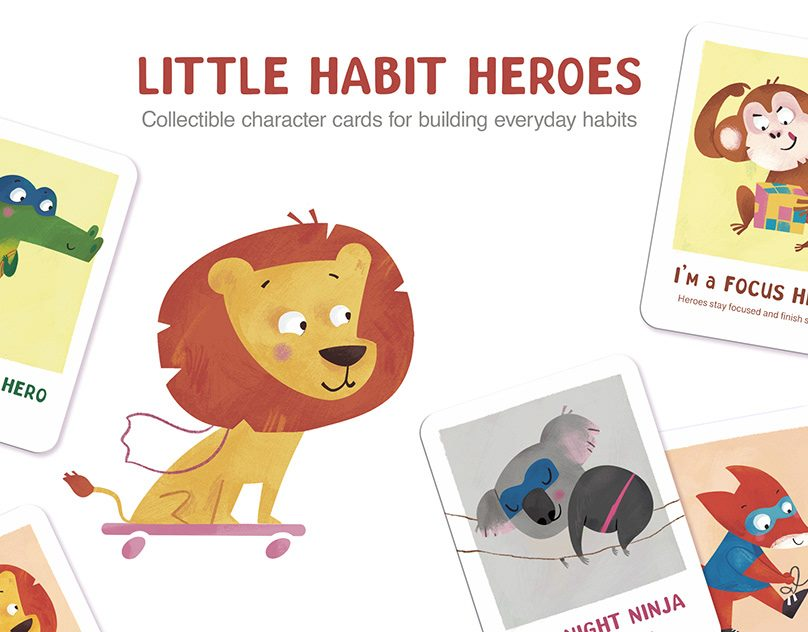
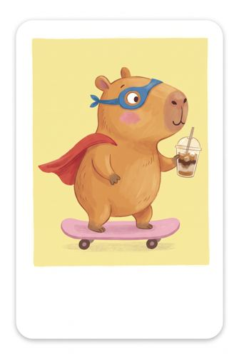
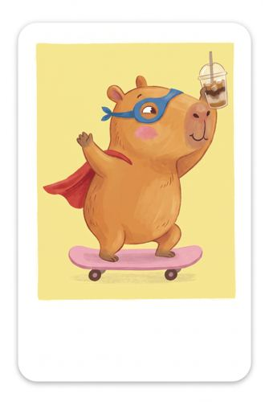
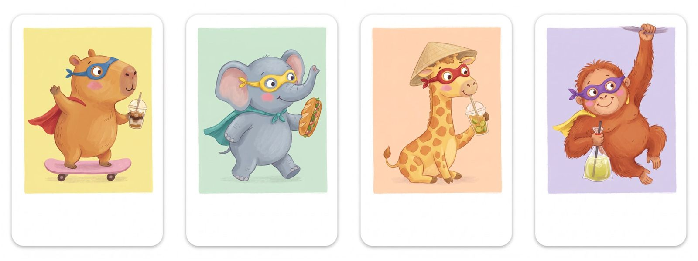
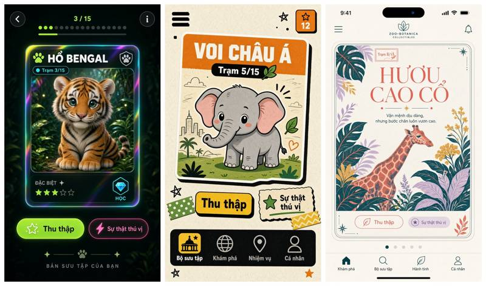
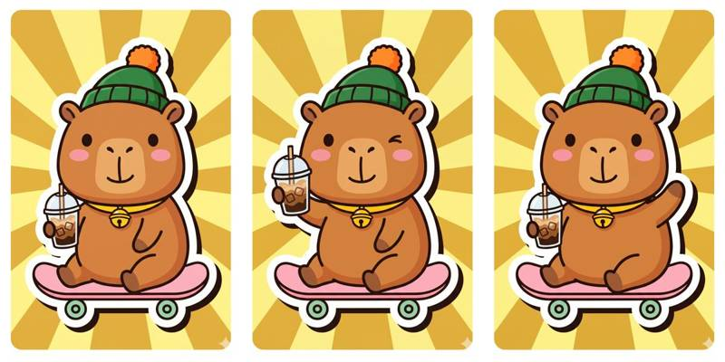

# 04 · Art style – theo Little Habit Heroes

## Chốt
- 🎨 Chất **gouache** kiểu tranh sách thiếu nhi, có vân cọ.
- ✏️ Nét viền **mảnh, cùng tông** với con vật (không viền đen).
- 🦸 Mỗi con đeo **mặt nạ siêu anh hùng + áo choàng**.
- 🛵 Mỗi con một **phụ kiện Sài Gòn** (bánh mì, nón lá, cà phê sữa đá…).
- 🟨 **Nền thẻ pastel** một màu, khung trắng bo góc, **chừa trống chỗ ghi tên** phía dưới, không chữ trong ảnh.

## Mẫu chuẩn (master ref): capybara vẫy tay

Các bản thử khác:  

Test đồng bộ: 

## Hướng đã bỏ
- Mockup AI (Holo jungle / Sticker zine / Botanical pop) – nhìn "quá AI".
- Sticker pop viền đen dày + nền tia nắng – đổi sang nét Little Habit.

 
