# 05 · Motion – 2 wow moment

## 1. Lúc chạm NFC
✅ **Hướng đã duyệt:** thẻ hơi 3D kiểu **Pokémon TCG Pocket** (A1, A2).
🕓 **Combo đề xuất (chờ duyệt):** A1 xé bao → A9 thẻ bay ra giữa → A8 lật + nảy lò xo → A5 nghiêng thẻ theo gyro. Giảm độ bóng cho hợp chất gouache.

| Ref | Mô tả | Link |
|---|---|---|
| A1 | Pokémon TCG Pocket – xé bao rút thẻ | [xem](https://60fps.design/shots/poke-mon-tcg-pocket-swipe-packet-to-reveal-card-interaction) |
| A2 | Pokémon TCG Pocket – lật thẻ nảy lò xo | [xem](https://60fps.design/shots/poke-mon-tcg-pocket-card-flip-animation) |
| A3 | Mosso – thẻ bay lên rồi lật, rắc kim tuyến | [xem](https://mosso.video/library/card-flip-reveal/) |
| A4 | CodePen – confetti giấy rơi lắc lư | [xem](https://codepen.io/erayner/pen/ExYEByL) |
| A5 | Pokémon TCG Pocket – nghiêng 3D, ánh sáng chạy | [xem](https://60fps.design/shots/poke-mon-tcg-pocket-3d-card-move-around-tooltip) |
| A6 | Pokémon TCG Pocket – bao thẻ xoay vòng 3D | [xem](https://60fps.design/shots/poke-mon-tcg-pocket-3d-spin-packet-picker-interaction) |
| A7 | Pokémon TCG Pocket – thẻ bay xoáy rồi xếp | [xem](https://60fps.design/shots/poke-mon-tcg-pocket-card-shuffle-interaction) |
| A8 | How We Feel – lật thẻ nảy lò xo | [xem](https://60fps.design/shots/how-we-feel-check-in-card-flip) |
| A9 | Thẻ holo web, bay ra giữa, nghiêng theo tay | [xem](https://poke-holo.simey.me/) |
| A10 | Xé bao kiểu Pokémon Pocket (Rive) | [xem](https://contra.com/p/q3MWgbOU-rive-pokemon-pocket-style-interactive-card-pack-opening) |
| A11 | Apple Weather – lật thẻ dọc, nền tối mờ | [xem](https://60fps.design/shots/apple-weather-widget-forecast-location-flip-interaction) |

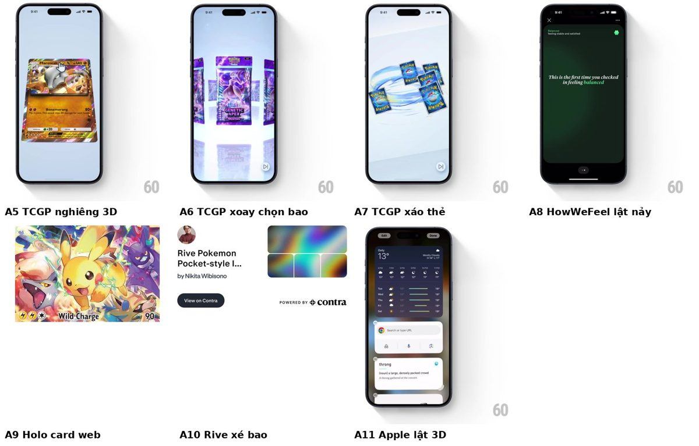

| A5 | A8 | A9 | A10 |
|---|---|---|---|
| 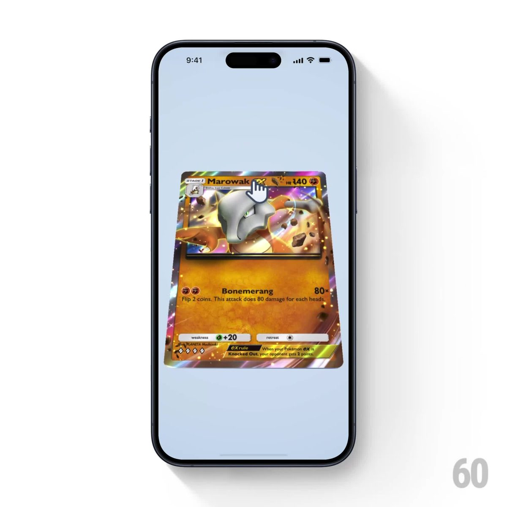 | 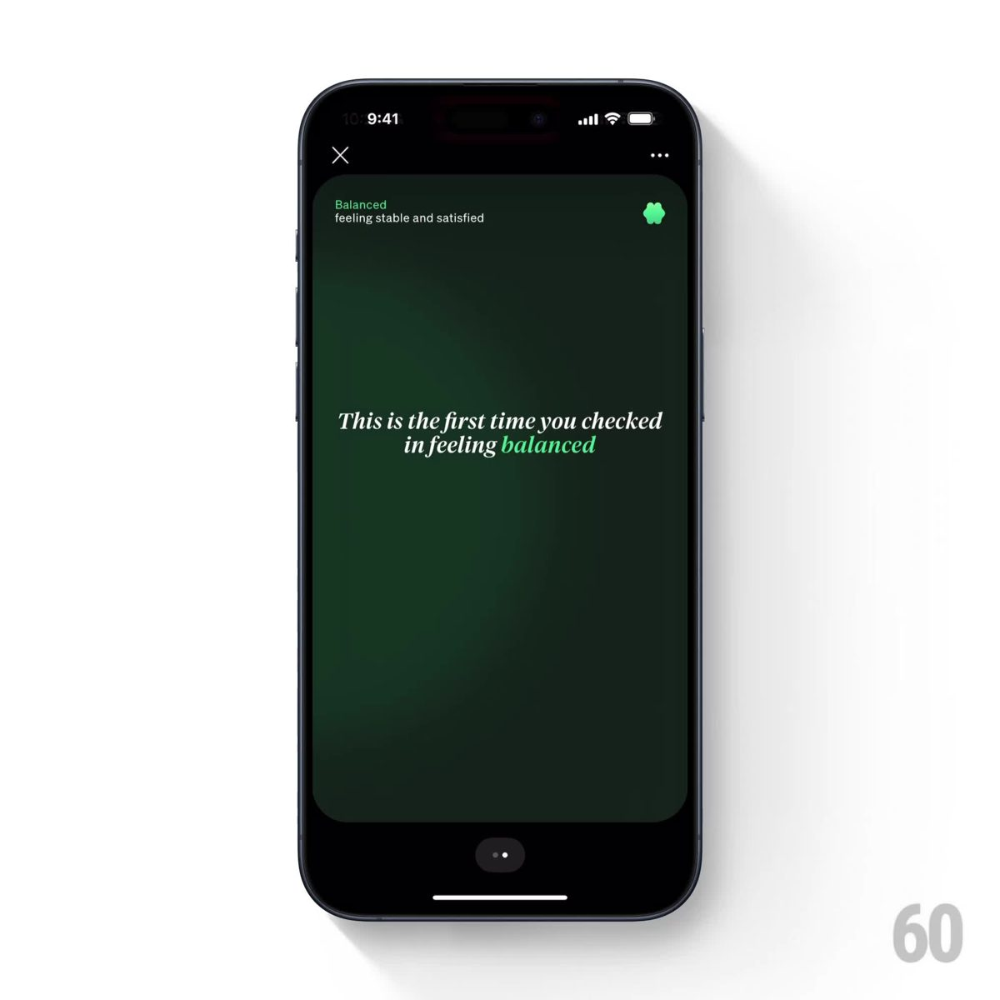 |  | 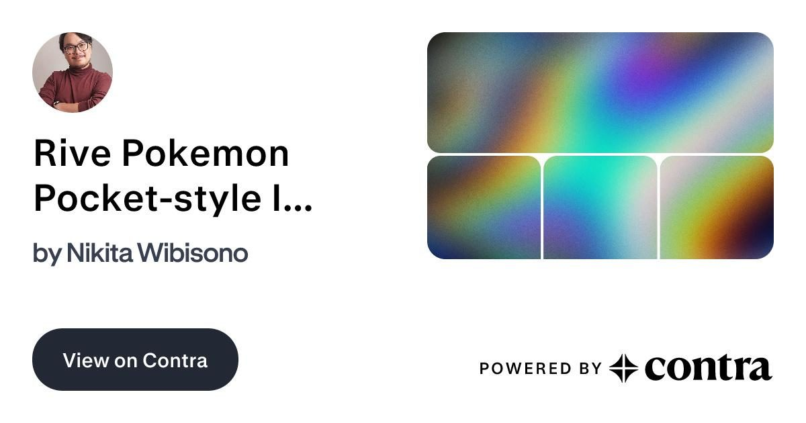 |
| **A6** | **A7** | **A11** | **TCG Pocket** |
| 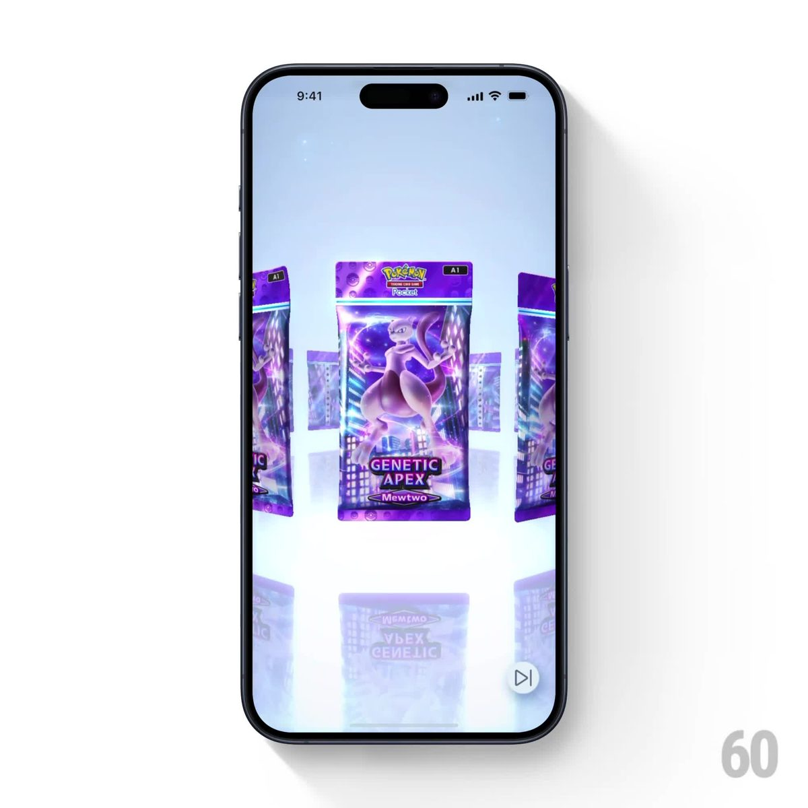 | 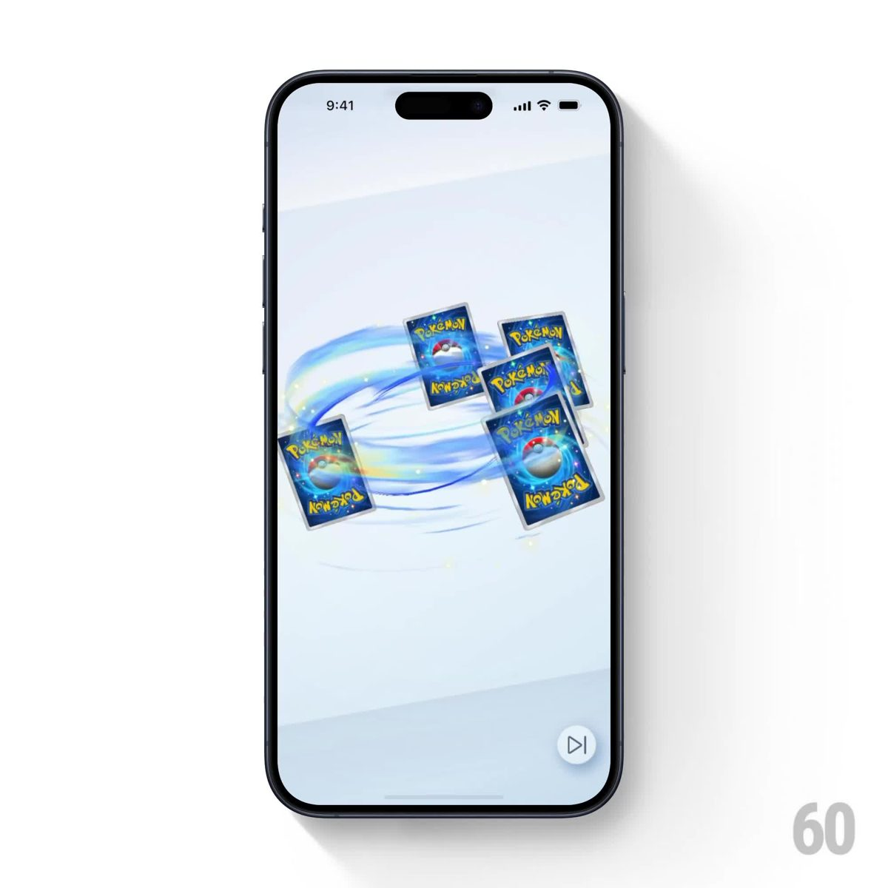 | 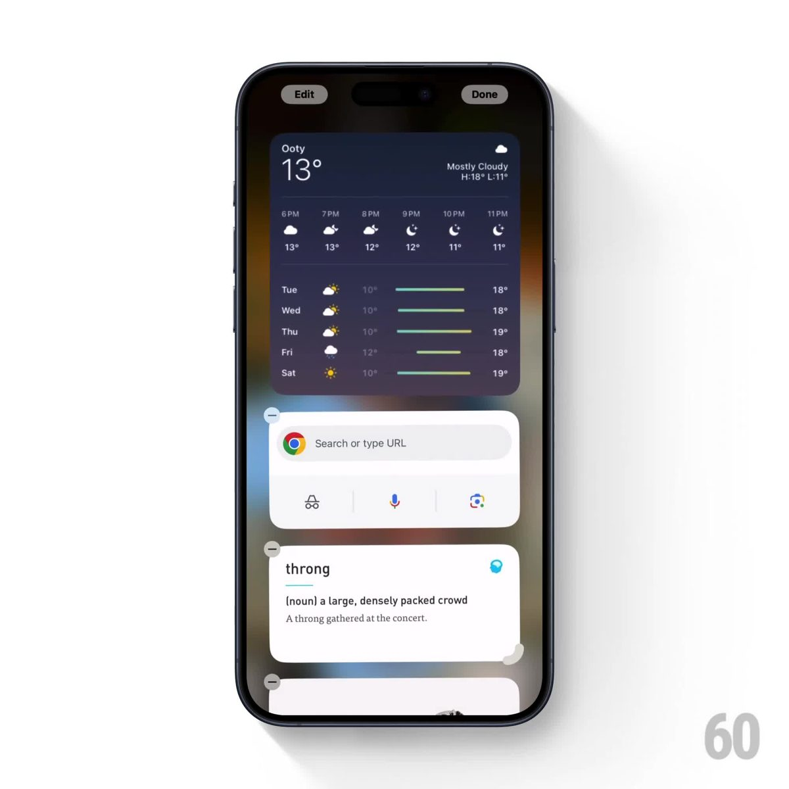 |  |

## 2. Video Wrapped
✅ **Theo cấu trúc B3 – Duolingo 2025 Recap:** story dọc, mỗi slide một chỉ số, mascot nảy, cuối mở thẻ thưởng rồi share.

| Ref | Mô tả | Link |
|---|---|---|
| B1 | Stop motion bằng giấy thật | [xem](https://www.behance.net/gallery/91260109/2020-stop-motion-animation) |
| B2 | The Year – giấy cắt | [xem](https://www.behance.net/gallery/240983703/The-Year-paper-art) |
| **B3** | **Duolingo 2025 Recap** | [xem](https://60fps.design/shots/duolingo-2025-recap-animation) |
| B4 | Oliver Jeffers – tổng kết năm vẽ tay | [xem](https://debutart.com/news/148-mac-premo-oliver-jeffers-the-dailys-review-of-the-year-2011) |

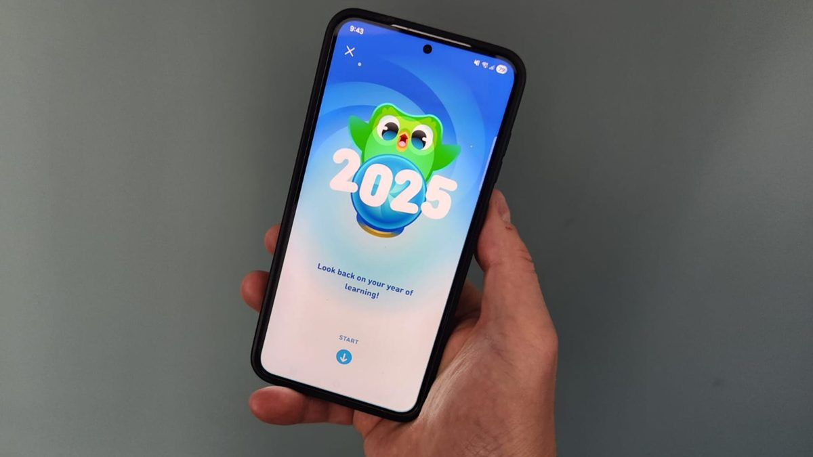 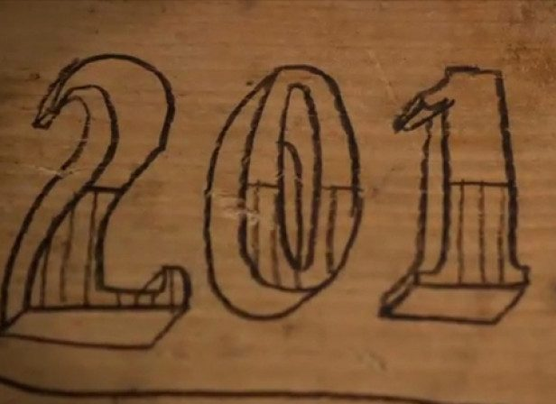

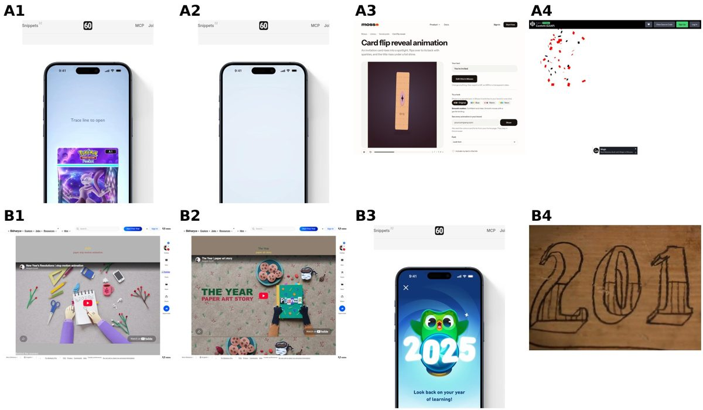

## Cách làm
HTML + CSS + JavaScript (không dùng GIF) → nhẹ, nét, đưa thẳng vào web. Bản thử: [demo/](../demo/) · video: [demo-phone.mp4](../demo/demo-phone.mp4)

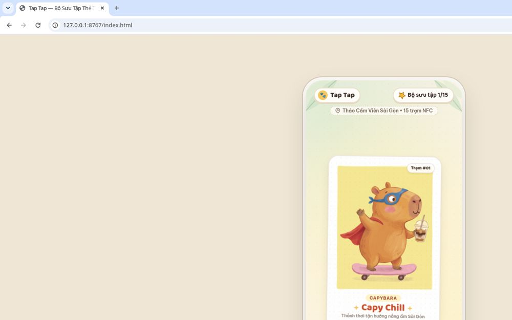
